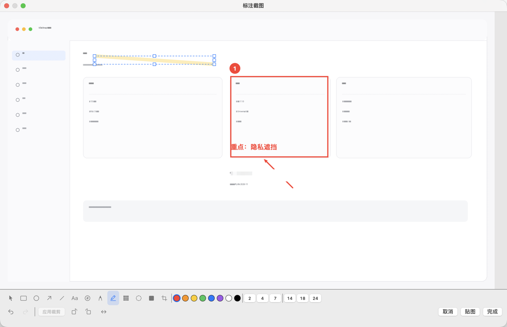
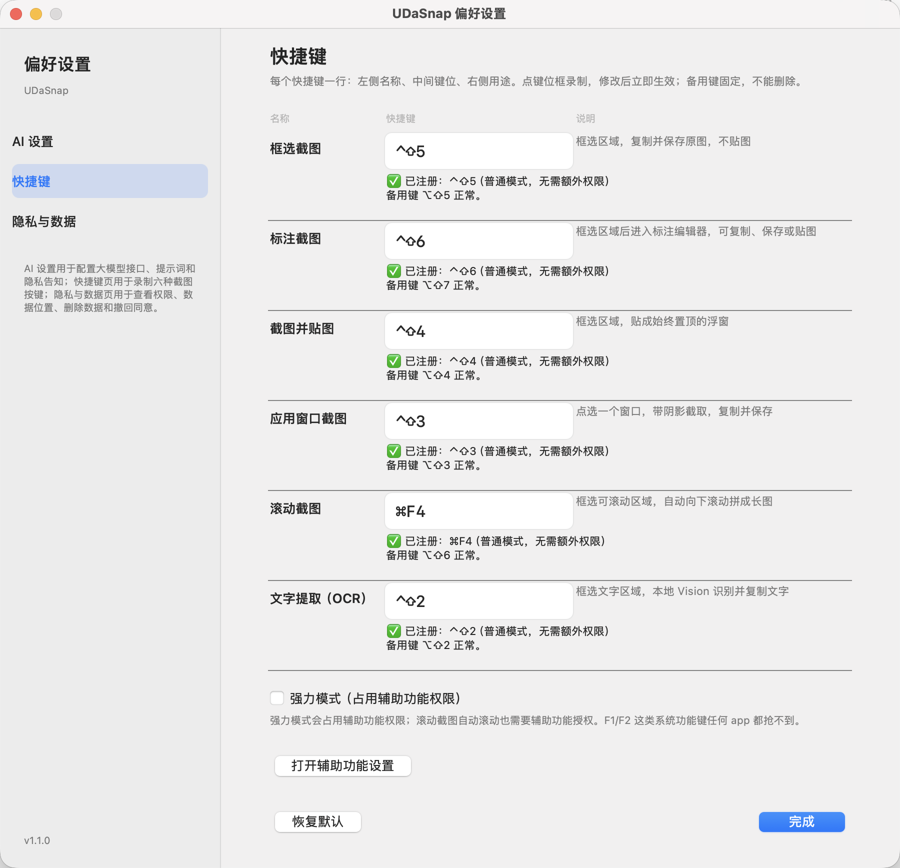
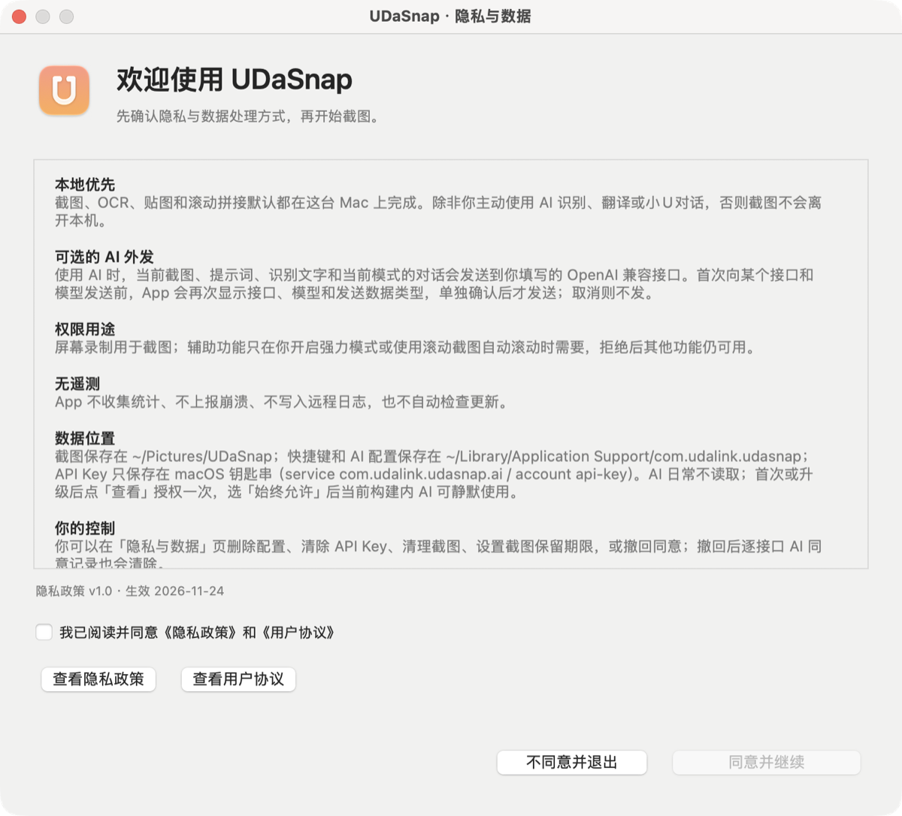

# UDaSnap

**截图即用。**  
**Capture. Understand. Use.**

UDaSnap 是一个 macOS 菜单栏截图工具。框选、标注、贴图、滚动长图、OCR、AI 理解与翻译，都在同一条从屏幕到结果的链路里完成。

当前版本：`1.1.0` / build `2`。


## 为什么是“截图即用”

截图不该停在“保存到桌面”。UDaSnap 把截图之后最常用的动作直接接到选区松手的那一刻：

- 需要参考图：框选后变成始终置顶、可拖动、可缩放的浮窗。
- 只需要一张图：框选后复制到剪贴板并保存，鼠标旁只闪一下提示。
- 需要某个窗口：点选窗口，连阴影一起截下来。
- 需要一整页：框选可滚动区域，自动滚动并拼接成长图。
- 需要文字：框选文字区域，Vision 在本机识别成可编辑文本。
- 需要圈重点或遮挡隐私：在独立标注编辑器里加框、箭头、文字、序号、马赛克，完成后复制或贴图。
- 需要理解或翻译：把截图交给可配置的 OpenAI 兼容接口，左图右文，继续追问。

## 功能

- **六种热键入口**：贴图、框选保存、标注、窗口截图、滚动截图、文字提取；菜单栏另有全屏截图、AI 分析、截图并翻译。
- **标注编辑器**：框选、窗口、全屏截图都可进入标注；矩形、椭圆、箭头、直线、文字、序号、画笔、高亮、马赛克、模糊、色块、裁剪，支持撤销/重做、旋转与翻转。
- **标注输出**：点“完成”复制并保存一张最终 PNG；点“贴图”再生成始终置顶的浮窗。隐私遮挡在导出时烘焙进像素，不保留遮挡下的原内容。
- **框选即贴 / 即存 / 即滚 / 即文字 / 即 AI / 即翻译**：拖出选区，松手即进入对应结果，不需要再点一次“开始”。
- **贴图浮窗**：始终置顶、跨桌面、8 向缩放、滚轮缩放、`Delete` 或右上角关闭。
- **滚动长图**：自动滚动、手动接管、拼接后弹出可缩放预览。
- **本地 OCR**：使用 macOS Vision，识别结果可编辑、可复制；支持智能合并视觉换行。
- **AI 双模式**：文字提取与内容理解，各自缓存结果、上一版与对话；SSE 流式回答可停止。
- **逐段翻译**：源语言自动检测，目标语言可选简中 / 繁中 / 英 / 日 / 韩；原文与译文交错显示。
- **统一偏好设置**：AI、快捷键、隐私与数据三页；六个热键均可重录，支持强力模式。
- **隐私默认本地**：截图、滚动拼接、OCR 默认不联网；只有主动触发 AI 才发送到你配置的接口。
- **无遥测**：不收集统计、不上报崩溃、不自动检查更新、不投放广告。





更完整的功能说明见 [docs/USAGE.md](docs/USAGE.md)。

## 系统要求

| 项 | 要求 |
|---|---|
| 系统 | macOS 14 (Sonoma) 及以上 |
| 架构 | Universal（arm64 + x86_64）；Apple Silicon 已实测，Intel 未实机验证 |
| 工具链 | Xcode Command Line Tools（`xcode-select --install`）或完整 Xcode |
| 权限 | 屏幕录制必需；辅助功能仅“强力模式”和滚动自动滚动需要 |
| 网络 | 可选，仅 AI 功能需要访问你配置的接口 |

## 安装

UDaSnap 通过 GitHub 分发，不发布 Mac App Store 版本。推荐从源码构建；预编译包是未签名构建，只适合愿意自行评估风险的用户。

### A. 从源码构建（推荐）

```bash
git clone https://github.com/UDaLink/UDaSnap.git
cd UDaSnap

bash ./build.sh            # 产物：dist/UDaSnap.app
bash ./build.sh install    # 安装到 /Applications/UDaSnap.app
```

构建脚本默认 ad-hoc 签名，适用于本机开发与自用。若你已有固定签名证书，可显式传入：

```bash
SIGN_IDENTITY="Your Codesigning Identity" bash ./build.sh install
```

首次运行请在“系统设置 → 隐私与安全性 → 屏幕录制”中允许 UDaSnap，然后重新打开应用。

### B. 预编译包

Release 页面提供 `UDaSnap-1.1.0-macos-universal-unsigned.zip` 与 `SHA256SUMS.txt`。该包是 ad-hoc 签名的 Universal 构建，**未使用 Apple Developer ID 签名、未公证**，`spctl` 会拒绝它，Gatekeeper 可能阻止首次打开。它不是面向普通用户的安全安装路径；需要可信构建时请使用 A 路径，或自行重新签名。

## 隐私

- 截图默认保存在 `~/Pictures/UDaSnap/`。
- 配置保存在 `~/Library/Application Support/com.udalink.udasnap/`。
- API Key 只保存在 macOS 钥匙串（service `com.udalink.udasnap.ai` / account `api-key`），不写入配置文件。
- 远程 AI 接口只允许 HTTPS；HTTP 仅允许 localhost、局域网地址和 `.local` 主机。
- 首次启动需要同意《隐私政策》和《用户协议》；首次向某个“接口 + 模型”发送数据前，还会单独确认接口 host、模型与发送内容。



详见 [PRIVACY.md](PRIVACY.md)、[TERMS.md](TERMS.md) 与 [SECURITY.md](SECURITY.md)。

## 开发

```bash
swift build          # debug 构建
bash ./build.sh      # Universal release + .app
swift format lint -r Sources Tests   # 格式检查（需 swift-format）
```

架构、目录约定、并发模型与测试方式见 [docs/ARCHITECTURE.md](docs/ARCHITECTURE.md) 和 [docs/DEVELOPMENT.md](docs/DEVELOPMENT.md)。

## 许可证

源代码以 [MIT License](LICENSE) 授权。UDaSnap 名称、图标和文档版权归项目维护者所有。
